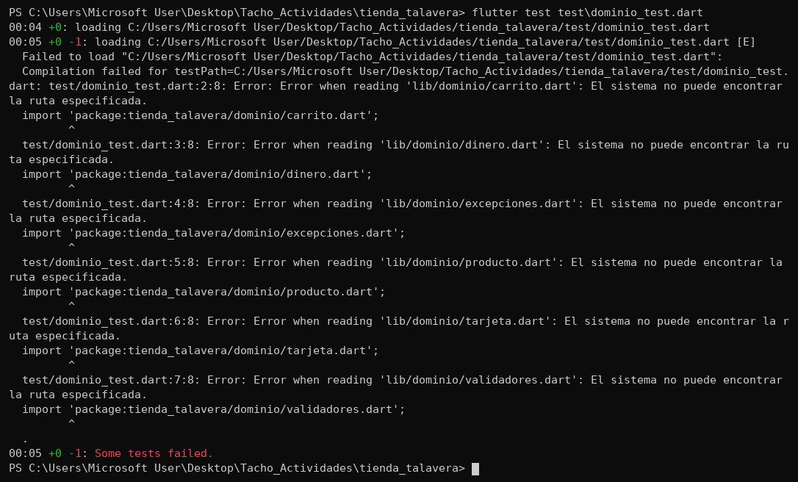
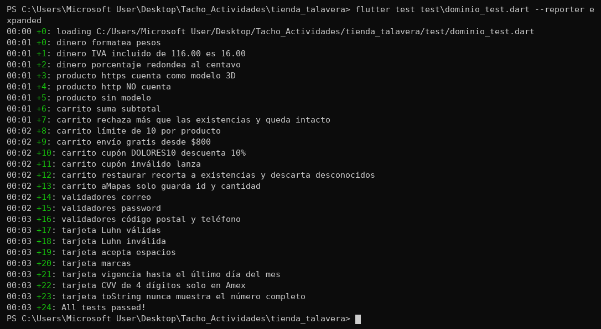
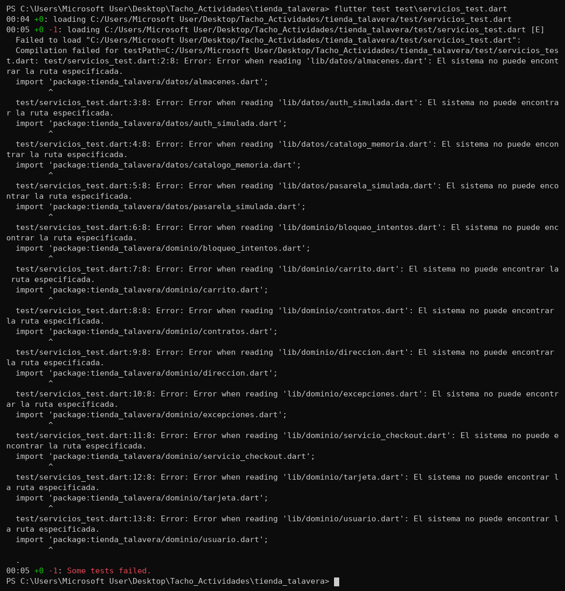
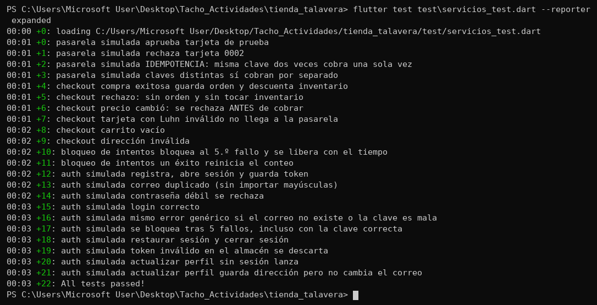
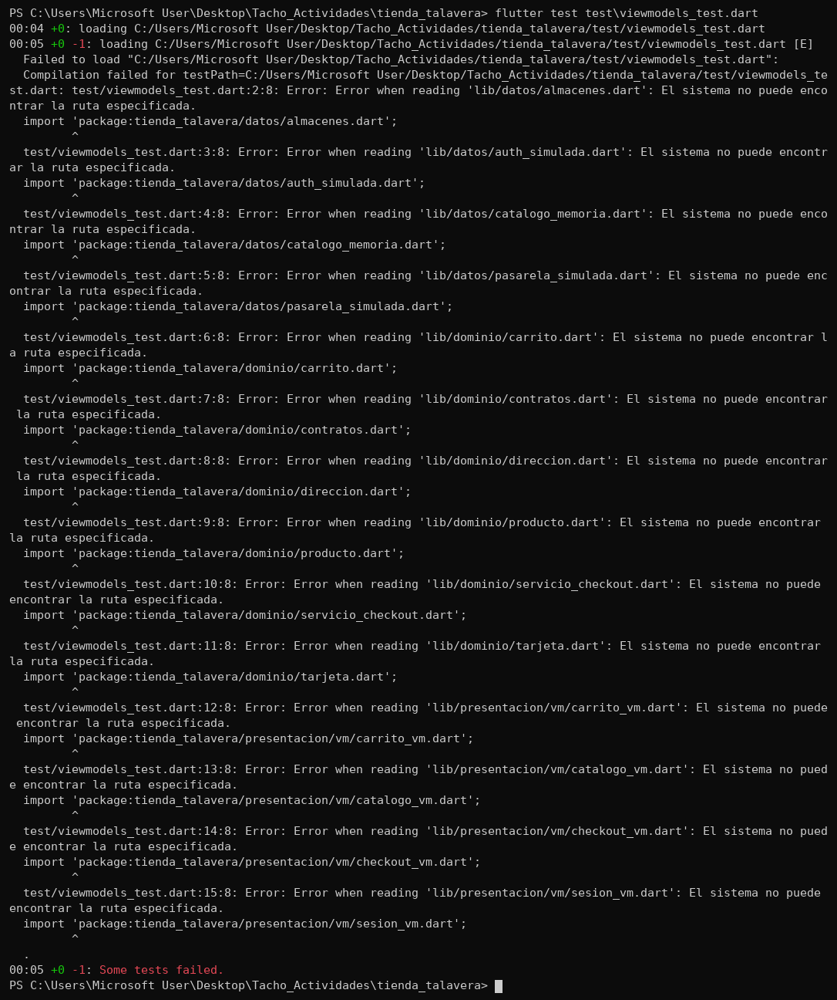
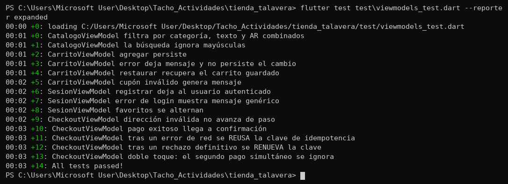
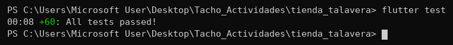

# Talavera Dolores — Tienda móvil con realidad aumentada

App de comercio electrónico en **Flutter** construida con **TDD (Rojo → Verde → Refactor)** para vender
artesanías de talavera de Dolores Hidalgo: **catálogo, carrito, pagos, perfil de usuario y "Ver en tu espacio"**
con realidad aumentada.

- **Materia:** Desarrollo Móvil Integral — UTNG
- **Profesor:** Anastacio Rodríguez García

> ⚠️ Usa una pasarela de pagos y un servidor de cuentas **simulados**. Nunca procesa dinero real.

---

## ¿Qué hace la app?

| Módulo | Qué hace |
|---|---|
| 🏺 **Catálogo** | Lista de productos con búsqueda, precio con IVA incluido y existencias. |
| 🔍 **Detalle** | Información del producto y su modelo 3D. |
| 📱 **Ver en tu espacio** | Muestra el producto en 3D y en realidad aumentada (Scene Viewer en Android, AR Quick Look en iPhone). |
| 🛒 **Carrito** | Agregar y quitar productos, cupones, envío gratis; se guarda al cerrar la app. |
| 💳 **Checkout** | Pago con tarjeta validada con Luhn, idempotencia (nunca cobra dos veces) y revalidación de precios. |
| 👤 **Perfil** | Registro, inicio de sesión, dirección y "Mis compras". Contraseñas con sal + hash y bloqueo tras 5 intentos. |

**Tarjetas de prueba**
- `4242 4242 4242 4242` → pago aprobado
- `4000 0000 0000 0002` → pago rechazado

---

## Estructura del proyecto

```
tienda_talavera/
├─ lib/
│  ├─ dominio/        reglas del negocio (Dart puro): dinero, producto, carrito, validadores,
│  │                  direccion, tarjeta, usuario, orden, excepciones, contratos,
│  │                  servicio_checkout, bloqueo_intentos
│  ├─ datos/          catalogo_memoria, almacenes, pasarela_simulada, auth_simulada
│  ├─ presentacion/
│  │   ├─ vm/         catalogo_vm, carrito_vm, sesion_vm, checkout_vm
│  │   └─ pantallas/  catalogo, detalle, ver_en_tu_espacio, carrito, checkout, perfil
│  ├─ dependencias.dart   raíz de composición
│  └─ main.dart
├─ test/
│  ├─ dominio_test.dart       (24 pruebas)
│  ├─ servicios_test.dart     (22 pruebas)
│  └─ viewmodels_test.dart    (14 pruebas)
├─ capturas/                  evidencias del ciclo rojo / verde
├─ paso1_ROJO.ps1
├─ paso2_VERDE.ps1
└─ pubspec.yaml
```

**60 pruebas en total.**

Paquetes: `model_viewer_plus`, `shared_preferences`, `flutter_secure_storage`, `crypto`.

---

## Cómo ejecutarlo

### 1. Preparar el proyecto
En PowerShell, dentro de la carpeta `tienda_talavera`:

```powershell
flutter create .
Remove-Item test\widget_test.dart
flutter pub get
```

`flutter create .` agrega las carpetas de plataforma (android, web, windows…) sin tocar tu código.
Se borra `widget_test.dart` porque usa `MyApp`, que aquí no existe.

### 2. Permiso de internet (Android)
El visor 3D funciona dentro de un WebView. En `android/app/src/main/AndroidManifest.xml`, dentro de `<manifest>`:

```xml
<uses-permission android:name="android.permission.INTERNET"/>
```

> La realidad aumentada solo funciona en un **teléfono físico** compatible con ARCore y con
> "Google Play Services for AR". En el emulador se ve el 3D, pero no la AR.

### 3. Pruebas
```powershell
flutter test
```

### 4. Correr la app
```powershell
flutter run -d edge     # en el navegador
flutter run             # en tu celular Android conectado por USB
```

---

## Ciclo TDD — Evidencias

🔴 **ROJO:** se escribe la prueba primero; falla porque el código todavía no existe.
🟢 **VERDE:** se escribe el código mínimo para que la prueba pase.
🔵 **REFACTOR:** se ordena el código sin romper las pruebas.

### 1. Dominio (dinero, producto, carrito, validadores, tarjeta)
**🔴 Rojo**



**🟢 Verde**



### 2. Servicios (pasarela, checkout, bloqueo de intentos, autenticación)
**🔴 Rojo**



**🟢 Verde**



### 3. ViewModels (catálogo, carrito, sesión, checkout)
**🔴 Rojo**



**🟢 Verde**



### 4. Todas las pruebas


---

## Lista de verificación

- [x] `flutter test` pasa en verde con todas las pruebas.
- [x] Compras con 4242 4242 4242 4242 y ves la orden en "Mis compras".
- [x] La tarjeta 4000 0000 0000 0002 muestra el rechazo y NO descuenta inventario.
- [x] Cerrar y reabrir la app conserva carrito y sesión.
- [x] Cinco intentos de login fallidos bloquean la cuenta.
- [x] "Ver en tu espacio" abre el visor 3D (y la AR en un teléfono compatible).
